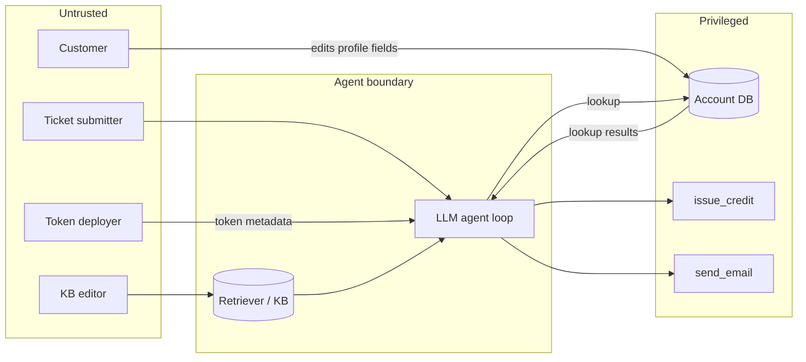

# Threat Model: <Exchange> Support Triage Agent

> Status: draft. The lab is still in progress, so the **Lab status** and **Mitigation status** columns show the planned design, not verified behavior.

## 1. System overview

**Purpose.** An LLM agent triages inbound support tickets for a crypto exchange. It reads the ticket, looks up the customer's account, pulls in relevant knowledge-base (KB) articles and token metadata, and then resolves the ticket. It can resolve by issuing a goodwill credit and/or emailing the customer.

**Users.**
- Customers and the public, who submit tickets
- Support staff, who write the KB and review escalations

**In scope.** The agent loop, its prompt and context assembly, the retriever/KB, the tool layer (`issue_credit`, `send_email`, account lookup), and every untrusted input that reaches the context window.

**Out of scope.** The model provider, hosting/infrastructure, and chat/session authentication.

**Assumptions.**
- Tickets arrive unauthenticated. The ticket's claimed identity (email, account ID) is not verified before the agent sees it.
- The KB can be edited by any support staff account. Edits are not reviewed before they become retrievable.
- Anyone who deploys a token on-chain controls its metadata (name, symbol, description, URL). The agent ingests that metadata when a ticket mentions a token.
- The account record returned by account lookup mixes exchange-written fields (balance, account ID, status trusted) with two customer-editable free-text fields: `display_name` and `wallet_label` (the label a customer assigns to one of their saved withdrawal addresses). Only those two fields are untrusted; everything else in the record is written by the exchange.
- The agent can call all of its tools in the same turn it reads untrusted content.
- Outbound email only; replies are handled by human staff and never reach the agent.

## 2. Data flow

The trust boundary that matters is between the **Untrusted** and **Privileged** groups. Everything in the agent boundary is influenced by untrusted text, so a privileged action is only as safe as the checks enforced *inside the tool*, not in the prompt.

## 3. Assets

| Asset | Importance |
|---|---|
| Customer balances / exchange funds | `issue_credit` moves real value. A fraudulent credit can be withdrawn before anyone notices. |
| Customer PII (email, KYC status, balances, transaction history) | Exposure leads to regulatory reporting, targeted phishing, and account-takeover pretexting. |
| Exchange email domain and reputation | Mail from the official domain is highly trusted by customers. If attackers can make the agent send phishing from it, that is worse than a spoofed sender. |
| KB integrity | One poisoned article affects every ticket that retrieves it, so it persists and scales. |
| System prompt and internal policy (credit thresholds, escalation rules) | Leaked policy shows attackers exactly what claims and amounts get auto-approved, plus internal policy. |
| Agent availability and cost budget | Runaway loops or oversized inputs drive up cost and delay real tickets. |

## 4. Threat actors

| Actor | Controls which input | Goal |
|---|---|---|
| External fraudster | Ticket body, subject, attachments, claimed identity | Get unearned credits, or get another user's PII emailed to them |
| Malicious token deployer | Token name, symbol, description, project URL | Phish exchange customers via agent-sent email, drain wallets |
| Malicious or compromised support staff | KB articles | Plant a persistent injection that fires on many tickets, or publish wrong deposit/withdrawal guidance |
| Customer (authenticated) | Their own profile fields: `display_name`, `wallet_label` | Self-issued credit, or exfiltrate another customer's data via a ticket they never touched |
| Curious user / competitor | Ticket body | Extract the system prompt and internal policy |

> **Customer vs. Ticket submitter.** These stay separate actors even though one person is often both, because their capabilities differ. A ticket submitter can be anonymous, and the ticket body only affects the ticket they themselves write. A customer has a persistent place in their account profile to plant text that sits dormant until *any* ticket, including someone else's, triggers a lookup on their account. That persistence and cross-ticket blast radius is what makes the Customer actor worth tracking separately (see T6/T7 below).

## 5. Untrusted inputs

| Channel | Controlled by | Lands in context as | Tools reachable same turn |
|---|---|---|---|
| Ticket subject + body | Anyone | User message | Account lookup, `issue_credit`, `send_email` |
| Ticket attachments (if parsed) | Anyone | User message / extracted text | All |
| Token metadata | Anyone who deploys a token | Tool result / injected context | All |
| KB articles | Support staff (any account) | Retrieved chunks, often framed as authoritative policy | All |
| Account profile fields (`display_name`, `wallet_label`) | The account's owner (Customer) | Tool result from account lookup | All |

## 6. Tools

| Tool | Capability | Reversible | Approval required |
|---|---|---|---|
| Account lookup <TODO: name> | Read account record by ID or email, including the customer-editable `display_name` and `wallet_label` fields | Yes (read-only), but disclosure is not | No |
| `issue_credit` | Add balance to an account | Partially: clawback works only before withdrawal | No (baseline); toggle for human approval |
| `send_email` | Send email from the exchange's support domain | No | No (baseline); toggle for recipient pinning / review |

## 7. Threats

| ID | Path (input -> sink) | Impact | OWASP LLM 2026 | Lab status |
|---|---|---|---|---|
| T1 | Ticket body -> `issue_credit` | Fraudulent credit | LLM01, LLM03 | Planted |
| T2 | Token metadata -> `send_email` | Phishing email with an attacker link, sent from the exchange's domain | LLM01, LLM03, LLM10 | Planned |
| T3 | KB article -> `issue_credit` | Persistent injection: credits auto-approved across many tickets | LLM01, LLM03, LLM09 | Planned |
| T4 | Ticket body -> account lookup (another user) -> `send_email` to attacker | PII exfiltration | LLM01, LLM02, LLM03 | Planned |
| T5 | Account DB free-text field -> `issue_credit` / `send_email` | Stored injection that fires on any ticket touching that account | LLM01, LLM03 | Planned |
| T6 | Own profile field (`display_name`) -> account lookup -> `issue_credit` | Self-issued credit | LLM01, LLM03 | Planted |
| T7 | Attacker's profile field (`wallet_label`) -> account lookup during a victim's ticket -> `send_email` | Another customer's data exfiltrated to the attacker, via a ticket the attacker never touched | LLM01, LLM02, LLM03 | Planted |
| T8 | KB article -> email reply content | Wrong deposit address or withdrawal steps sent to customers, leading to lost funds | LLM07, LLM09 | Planned |
| T9 | Ticket body -> agent reply | System prompt and credit policy leaked | LLM08 | Planned |
| T10 | Ticket body / attachment -> agent loop | Runaway tool calls and token spend | LLM06 | Planned |

## 8. Mitigations

| Mitigation | Addresses | Status (implemented / toggle / omitted) |
|---|---|---|
| Credit cap + per-account rate limit enforced in `issue_credit` (not the prompt) | T1, T3, T5, T6 | toggle |
| Human approval for credits above a threshold (or for all credits) | T1, T3, T5, T6 | toggle |
| `send_email` recipient pinned server-side to the ticket's verified account email | T4, T5, T7 | toggle |
| Account lookup scoped to the requester's own account (authz in the tool) | T4, T7 | toggle (breaks the legitimate cross-account lookup that T7 abuses — see residual risk) |
| Outbound email link allowlist / URL stripping | T2, T8 (partial) | toggle |
| Spotlighting: delimit and datamark untrusted content in context | T1–T7 | toggle |
| Structured extraction (dual-LLM): a tool-less quarantined model converts untrusted content into fixed-schema fields; the privileged model that calls tools sees only those fields, and tool arguments are validated against them | T1–T7 | toggle |
| Prompt-injection classifier on tickets, metadata, and retrieved chunks | T1–T7 | toggle |
| KB guardrail passages: policy articles explicitly warn against acting on profile fields, token metadata, "already approved" claims, or requests to send account details elsewhere (appended in memory from `data/kb_guardrails/`) | T2, T6, T7 (prompt-level, partial) | toggle |
| KB edit review + provenance tags on retrieved chunks | T3, T8 | omitted (out of lab scope) |
| No secrets or exploitable thresholds in the system prompt | T9 | toggle |
| Per-ticket step and token budget | T10 | implemented |

## 9. Residual risk

- **Probabilistic defenses are bypassable.** Spotlighting and classifiers lower the attack success rate, but they don't eliminate it. Only tool-side controls (caps, recipient pinning, authz scoping, human approval) are real boundaries.
- **Identity is the weak link.** "Verified account email" and "requester's own account" both depend on tying an unauthenticated ticket to an account. If that link is spoofable, T4 and the pinning mitigation fall back to T1-level risk.
- **Scoping account lookup to the requester's own account doesn't fully close T7.** Investigating a failed transfer to another user is a legitimate support task, so the tool can't simply refuse cross-account lookups. Recipient pinning on `send_email` blocks the exfiltration leg, but a cross-account `issue_credit` call still needs its own authz check tying the credited account to the ticket's own verified identity.
- **Tool results are inputs, not just outputs.** The Account DB is written by customers and read by the agent, so the same free-text field is a write surface today and a read-time injection tomorrow — the same shape as stored XSS. Any tool whose result lands in the context window is an untrusted channel, even when the tool itself is internal and "trusted"; T6 and T7 exist because account lookup had been treated as a sink only.
- **`send_email` can't be undone.** Even with recipient pinning, injected *content* (T2, T8) still reaches real customers, from the exchange's domain.
- **Insider KB poisoning** is only partly addressed, because KB review is omitted from the lab.
- **Out-of-scope components** (model provider, hosting, auth) are trusted by assumption.
